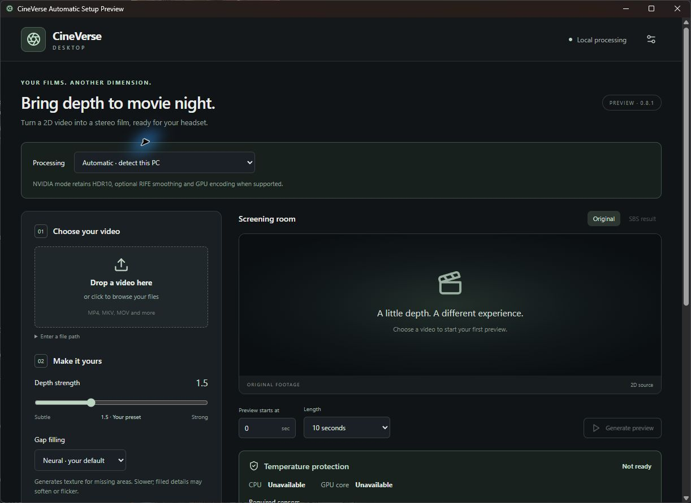

<div align="center">

# CineVerse Desktop

**Turn local 2D videos into side-by-side 3D for your VR cinema.**

[](https://github.com/fernandohmachado8/CineVerse-Desktop/releases/tag/v0.8.1-auto-setup-preview)  [](LICENSE)

[**Download for Windows**](https://github.com/fernandohmachado8/CineVerse-Desktop/releases/download/v0.8.1-auto-setup-preview/CineVerse-Automatic-Setup-Preview-0.8.1-x64-setup.exe) · [Setup guide](https://github.com/fernandohmachado8/CineVerse-Desktop/blob/v0.8.1-auto-setup-preview/docs/AUTOMATIC_HARDWARE_SETUP.md) · [Compare apps](docs/COMPARISON.md) · [0.8.1 source](https://github.com/fernandohmachado8/CineVerse-Desktop/tree/v0.8.1-auto-setup-preview)

</div>

CineVerse combines an inspectable desktop workflow with established open-source stereo and interpolation engines. Choose a video, preview its depth, and export a full SBS MP4 for Bigscreen or another compatible VR player. Conversion runs on your PC; your source file stays untouched.

**Public preview:** the Windows installer is unsigned. Physical NVIDIA testing covers an RTX 4090; other configurations still need community testing. Radeon acceleration is experimental. Read the [release notes and checksums](https://github.com/fernandohmachado8/CineVerse-Desktop/releases/tag/v0.8.1-auto-setup-preview) before installing.



_Actual Windows 0.8.1 interface before engine setup. No movie, generated scene or private path is shown._

## Get started

1. **Install the Windows preview.** No Python, Git or developer tools are needed.
2. In **Engine settings**, keep **Automatic**, choose an engine drive, acknowledge the downloads and click **Install engine automatically**. The app saves all dependency paths.
3. **Enable temperature protection.** Complete the normal Windows prompts for the signed sensor driver and read-only helper. Wait for the required readings.
4. **Drop in a video and choose an output folder.** Start at **depth 1.5 + neural gap filling**. Choose Original FPS, or optional **60 FPS smoothing** on the supported NVIDIA route.
5. **Generate a short preview** and review faces, edges, movement and cuts in your headset before a long conversion. Start with three seconds on CPU.
6. When satisfied, choose **Convert full video**, then **Open output folder**. In Bigscreen select **SBS, left eye first**, and check the image proportions.

First setup downloads several GB. Allow **15 GiB free**, or **25 GiB for AMD setup and possible CPU fallback**, plus movie workspace/output space. Setup needs internet access; local conversion requires no cloud account. Display drivers remain separate. Setup, launch and recovery never start a movie job automatically.

## What you get

- **Adjustable stereo depth** and neural filling for newly exposed regions; a faster filling method remains available.
- **Automatic setup:** hardware/driver detection, private dependencies, startup checks and CPU fallback when acceleration cannot start.
- **NVIDIA options:** supported HDR10 preservation, Main10 HEVC encoding and RIFE 60 FPS interpolation with scene-cut guards.
- **Progress, stage estimates and cancellation,** with recovery of completed stages after interruption.
- **Thermal supervision:** required-sensor checks, cutoffs and owned-process cleanup. Software monitoring cannot guarantee hardware safety.
- **Export verification:** source integrity, timing, prepared audio, source-eye detail samples and compatibility margins.

This creates stereoscopic depth on a virtual screen. AI synthesizes the second-eye view, missing regions and optional intermediate frames. It does not recover unseen original footage or create a walkable 360° environment.

## Hardware and formats

| Route                      | Capabilities                                                                                       | Verification status                                                                                                          |
| -------------------------- | -------------------------------------------------------------------------------------------------- | ---------------------------------------------------------------------------------------------------------------------------- |
| Windows NVIDIA             | SDR or supported HDR10; Original FPS or optional 60 FPS; up to 1920 pixels per eye                 | RTX 4090 tested. RTX 20/30/40/50-series are expected candidates, subject to driver, NVENC Main10, memory and runtime checks. |
| Windows CPU, Intel/AMD x64 | SDR, Original FPS, software H.264; up to 1280 pixels per eye                                       | Intel CPU tested; AMD CPU testing outstanding. CPU processing can be substantially slower.                                   |
| Windows 11 Radeon          | Allowlisted experimental ROCm recipe; SDR, Original FPS, software H.264; up to 1280 pixels per eye | Physical Radeon inference and sensor binding unverified. Unsupported configurations use CPU fallback in Automatic.           |
| Apple Silicon Mac          | Separate 0.7 preview; SDR, Original FPS; CPU by default, opt-in MPS                                | Hosted-runner CPU/MPS checks passed; no physical-headset certification. Ad-hoc signed; not notarized.                        |

Windows targets **Windows 10/11 x64**. The current CUDA runtime starts at Turing/SM 7.5; GTX 10-series and older use CPU fallback. There is no packaged Windows ARM, Intel Mac or Linux release. A startup probe does not establish maximum-resolution memory requirements or whole-movie reliability. See the [exact hardware recipe](https://github.com/fernandohmachado8/CineVerse-Desktop/blob/v0.8.1-auto-setup-preview/docs/AUTOMATIC_HARDWARE_SETUP.md) and [separate Mac download](https://github.com/fernandohmachado8/CineVerse-Desktop/releases/tag/v0.7.0-macos-preview).

## How it compares

| App                                                                        | Main role                                               | Where it fits                                                                                                                 |
| -------------------------------------------------------------------------- | ------------------------------------------------------- | ----------------------------------------------------------------------------------------------------------------------------- |
| **CineVerse Desktop**                                                      | Local desktop workflow around iw3                       | An open-source preview with inspectable setup, supervised jobs, verification reports and supported NVIDIA HDR/60 FPS options. |
| [iw3 / nunif](https://github.com/nagadomi/nunif/blob/master/iw3/README.md) | Open-source stereo converter with GUI and CLI           | CineVerse's stereo engine. Use it directly for its wider choice of models, parameters and formats.                            |
| [Owl3D](https://www.owl3d.com/)                                            | Commercial desktop converter and separate cloud service | A ready-made product with multiple stereo formats and free/paid plans. Features depend on platform, model and plan.           |
| [Immersity for Web](https://www.leiainc.com/faqs)                          | Browser-based depth, motion and 3D conversion           | An upload/export service. Animated depth effects and stereoscopic video are different output choices.                         |
| [Bigscreen](https://store.steampowered.com/app/457550/Bigscreen_Beta/)     | VR cinema and desktop viewing                           | A playback companion: CineVerse produces the file; Bigscreen provides the viewing environment.                                |

**CineVerse uses iw3's underlying method.** Its contribution is application and systems integration, not a newly trained stereo model. These are workflow comparisons, not measured quality or speed rankings. Read the [sourced comparison](docs/COMPARISON.md), checked on **31 October 2026**. No affiliation with these products is implied.

## Quality and practical limits

- Hair, fences, reflections, occlusions and cuts can produce stretching, softened detail or flicker. Stronger depth can amplify artifacts; preview each kind of material.
- HDR support is **HDR10 / BT.2020 / PQ** on the supported NVIDIA route. HLG and Dolby Vision preservation are rejected. RIFE is not HDR-trained; synthesized motion can contain artifacts.
- Input is normalized to its average frame rate, within the supported 1–60 FPS range. Output is not bit-identical to the source video.
- Export is **full SBS MP4**, with the first audio track converted to AAC stereo. Additional audio tracks and subtitles are omitted. MV-HEVC, half-SBS and top-bottom exports are not implemented.
- Black compatibility margins add rows without cropping movie pixels. Check codec, aspect-ratio and HDR playback support on your own headset/player.
- Recovery works **between stages**; an interrupted stage restarts. Long jobs need their own storage, cooling and quality review.

## Verification you can inspect

The **0.8.1 release** passed **147 local tests**: 93 Python, 30 React, 14 Windows watchdog and 10 Rust tests, plus [Windows/source CI](https://github.com/fernandohmachado8/CineVerse-Desktop/actions/runs/41254410161). Actual installer/upgrade and first-launch checks caught and fixed a hardware-detection path issue. [Release evidence](https://github.com/fernandohmachado8/CineVerse-Desktop/releases/download/v0.8.1-auto-setup-preview/VALIDATION.json) records the installed resources and engine checks.

Earlier [0.8.0 evidence](https://github.com/fernandohmachado8/CineVerse-Desktop/releases/download/v0.8.0-auto-setup-preview/VALIDATION.json) separately covers fresh private CPU setup, real AMD-package installation with simulated detection and working CPU fallback, and protected three-frame synthetic conversions. AMD wheels running on Intel CPU are **not Radeon GPU validation**. These fixtures do not certify movie quality, overnight load or speed. Clean-Windows-VM and broader physical hardware testing remain outstanding.

## Engineering and credits

| Area               | Application work                                                                                   |
| ------------------ | -------------------------------------------------------------------------------------------------- |
| React + TypeScript | Workflow, native drag/drop, capability-aware controls, preview and progress states                 |
| Tauri 2 + Rust     | Native commands, private-runtime bootstrap, checked assets and process ownership                   |
| Python + PyTorch   | iw3/RIFE adapters, hardware profiles, staged processing and structured progress events             |
| Video pipeline     | HDR10 metadata, timestamp-driven interpolation, audio checks and verified SBS publication          |
| Reliability        | Atomic checkpoints, source fingerprints, cancellation, sensor-loss handling and owned-tree cleanup |

Stereo inference comes from **[iw3/nunif](https://github.com/nagadomi/nunif)** and **[Depth Anything V2 Small](https://huggingface.co/depth-anything/Depth-Anything-V2-Small)**; interpolation comes from **[Practical-RIFE](https://github.com/hzwer/Practical-RIFE)**. No new AI model was trained. Development used AI coding assistance; this portfolio demonstrates integration, product engineering and measured verification. Read the [released architecture](https://github.com/fernandohmachado8/CineVerse-Desktop/blob/v0.8.1-auto-setup-preview/docs/ARCHITECTURE.md) for details.

## Build the published preview

The default branch preserves the earlier working code while preview changes are reviewed. **Use the release tag for source that matches the download.**

```powershell
git clone https://github.com/fernandohmachado8/CineVerse-Desktop.git
cd CineVerse-Desktop
git switch --detach v0.8.1-auto-setup-preview
npm ci
npm run dev
```

`npm run dev` opens a browser interface preview; native conversion is disabled there. Building the Windows app requires Node.js 22+, Rust MSVC, the Windows C++ tools/SDK and WebView2; see the [Tauri prerequisites](https://v2.tauri.app/start/prerequisites/). Python 3.12 is needed for source checks; end users use the app's private engine.

```powershell
python -m unittest discover -s tests -v
python -m unittest discover -s thermal -v
npm test
npm run format:check
npm run build
cargo test --manifest-path src-tauri/Cargo.toml --locked
npm run tauri -- build --config src-tauri/tauri.auto.conf.json --bundles nsis
```

Building does not provision the AI engine or start conversion. See [contributing](CONTRIBUTING.md) and the [setup guide](https://github.com/fernandohmachado8/CineVerse-Desktop/blob/v0.8.1-auto-setup-preview/docs/AUTOMATIC_HARDWARE_SETUP.md).

## Feedback and license

[Report a reproducible problem](https://github.com/fernandohmachado8/CineVerse-Desktop/issues/new?template=bug_report.yml) with the app version, OS, CPU/GPU, driver and processing mode. Use generated media where possible. Do not upload movies, model weights, credentials or unredacted private logs. See [security guidance](SECURITY.md) for sensitive reports.

Original application code is **MIT**, copyright Fernando Machado. Engines, models, codecs and drivers retain their own licenses; read the [0.8.1 third-party notices](https://github.com/fernandohmachado8/CineVerse-Desktop/blob/v0.8.1-auto-setup-preview/THIRD_PARTY_NOTICES.md). No movie footage, book content or pretrained weights are included. Use media you are authorized to process; the application license does not grant media rights.
