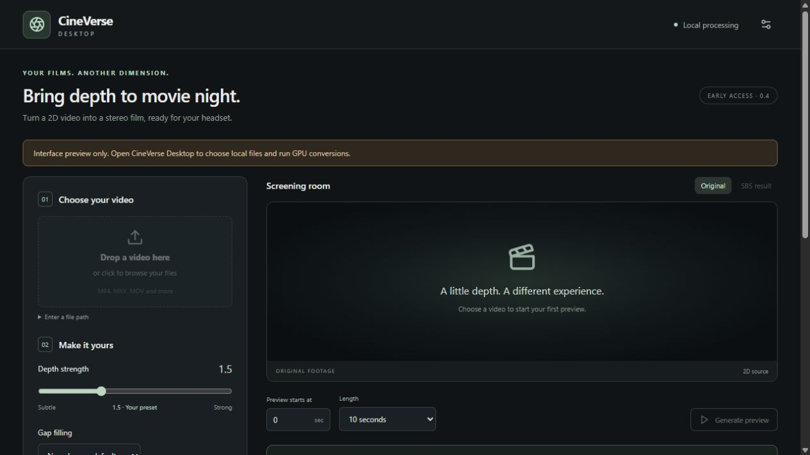

<div align="center">

# CineVerse Desktop

**Local 2D → stereoscopic video, built for a VR cinema.**

[](https://github.com/fernandohmachado8/CineVerse-Desktop/actions/workflows/checks.yml)


A desktop application that turns local videos into full side-by-side stereo for VR players, with per-conversion thermal supervision. Windows/NVIDIA offers optional motion interpolation and HDR10 preservation; the separate Apple Silicon preview starts with SDR at the original frame rate.

</div>



*Actual interface in browser-preview mode. Native processing is disabled; no movie or private settings are shown.*

## Automatic setup preview

The `feature/automatic-engine-setup` branch adds **CineVerse Setup Preview 0.6**. First launch can download its private Python, processing tools and model files, choose CPU/NVIDIA, and save all paths automatically. No Python or Git installation is required for end users. The existing working versions remain separate. See [first-run setup, driver approval and validation limits](docs/AUTOMATIC_SETUP.md).

## Apple Silicon preview

The separate `feature/macos-preview` branch adds **CineVerse Mac Preview 0.7**, targeting M1 and newer on macOS 14+. It provides automatic private-engine setup, CPU processing, opt-in experimental MPS, SDR/original FPS and Apple's system thermal-state supervision. HDR and RIFE smoothing are not implemented on Mac. The development app is **not Developer ID signed or notarized**. See [Mac setup, build commands and validation limits](docs/MACOS.md). Windows releases remain separate.

## Compatibility preview

The `feature/windows-cpu-compatibility` branch adds a separate **Windows CPU compatibility preview (0.5)**. It supports SDR/original FPS without NVIDIA, software H.264 and a bounded two-processor workload; HDR and 60 FPS remain NVIDIA features. The working 0.4 baseline stays on `main`. See [profiles, setup and measured limits](docs/COMPATIBILITY.md). This is not yet certified on most PCs.

## Features

- Drop a video, choose an output folder and generate a bounded preview before a long job.
- Adjust stereo depth. **1.5 + neural gap filling** is the tested preferred starting preset; the previous fast method remains available.
- Keep the original frame rate or synthesize **60 FPS** using RIFE with scene-cut guards.
- Preserve supported **HDR10 / BT.2020 / PQ**, use FP32 HDR interpolation and encode Main10 HEVC with NVIDIA NVENC. SDR exports use H.264.
- Follow progress and stage ETA; cancel or recover completed stages after interruption.
- Require fresh CPU/GPU readings by default and stop the conversion at temperature or sensor-loss limits.

This creates **depth on a virtual movie screen**. It does not reconstruct a walkable world or a 360° movie. The right eye, filled disocclusions and intermediate frames are synthesized and can contain artifacts.

## Engineering demonstrated

| Area | Implementation |
|---|---|
| Desktop and frontend | React, TypeScript, accessible controls, drag/drop, Tauri 2 and Rust commands |
| AI integration | Pinned iw3/Depth Anything V2 Small, neural gap filling and RIFE 4.25 adapters |
| Video engineering | Timestamp-driven resampling, scene-cut guards, HDR metadata/SEI, audio verification and NVENC |
| Reliability | Atomic checkpoints, source fingerprints, stage hashes, recovery and actionable errors |
| Windows systems | Process identity, job-object cleanup, narrowly elevated CPU sensing and independent supervision |
| macOS preview | Native arm64 bootstrap, private process groups, Apple system thermal-state supervision and separate packaging |
| Verification | Frontend/Python tests, Windows fault tests, synthetic fixtures and CI |

The original application work is integration and product engineering. **iw3, RIFE and the pretrained model authors provide the underlying research and inference engines.** No new AI model was trained for this project. Development used AI coding assistance; this portfolio documents implemented behavior and measured tests, without claiming novel model research.

See the [pipeline overview](docs/assets/overview.svg) and read the [architecture](docs/ARCHITECTURE.md), [validation](docs/VALIDATION.md) and [third-party notices](THIRD_PARTY_NOTICES.md).

## Preview the interface

With Node.js 22 or later:

```sh
npm ci
npm run dev
```

Open the printed localhost URL. This is a **read-only interface preview**; conversion requires a native app and configured engine. The [synthetic fixture generator](examples/generate_fixture.py) supplies analytical test geometry, not AI output or film footage.

## Build for Windows

Install Rust MSVC, Visual Studio C++ build tools/Windows SDK and WebView2 using the [Tauri prerequisites](https://v2.tauri.app/start/prerequisites/).

```powershell
npm ci
npm test
python -m unittest discover -s tests -v
npm run tauri -- build --bundles nsis
```

The unsigned installer packages the interface and application adapters. GPU drivers where needed, AI Python, FFmpeg and model weights are installed separately. Building this repository does not replace the original working CineVerse installation.

## Engine dependencies

Included: **npm/Cargo lockfiles, the tested Python environment snapshot, pinned upstream commits, model/download URLs and SHA-256 hashes**, plus a setup helper. Dependencies keep their upstream licenses and are fetched into a separate directory instead of being committed as binaries.

Install Windows x64 Python **3.12** and Git; the NVIDIA profile also needs a compatible NVIDIA driver. Review [dependency setup](docs/DEPENDENCIES.md) and [licenses](THIRD_PARTY_NOTICES.md). Planning downloads nothing:

```powershell
py -3.12 scripts/setup_engine.py --root "D:/CineVerse" --download-models
```

Execute the reviewed plan:

```powershell
py -3.12 scripts/setup_engine.py --root "D:/CineVerse" --install --download-models
```

Then choose **Locate engine folder** in the app. CPU sensing requires the official signed PawnIO driver separately and administrator approval for the read-only helper. Setup never installs drivers, changes Windows security or starts conversion. If Google Drive cannot serve RIFE, provide its verified official ZIP with `--rife-archive`.

**Clean-machine installation has not yet been certified.** Planning, safeguards, existing-engine checks and the working PC's runtime were tested separately; see [validation](docs/VALIDATION.md).

## Measured validation

- The compatibility branch has **84 passing local tests**: 52 Python worker/setup/protection/distribution tests, 18 React tests and 14 Windows legacy watchdog tests.
- A CPU-only synthetic three-second preview passed in **160.531 seconds**, versus **17.360 seconds** on the NVIDIA regression. These are single-workstation pipeline tests, not broad-PC performance claims; see [measurements](docs/VALIDATION.md).
- Historical 0.4 worker-CLI and **native button-driven three-second HDR/60 FPS previews** completed on an RTX 4090: 181 verified frames, preserved HDR10/prepared audio, zero timestamp-grid error and compatibility margins.
- The native run had 20 valid monitoring samples: CPU **73–86 °C**, GPU core **39.88–60.36 °C**. These short observations do not establish overnight or whole-film thermal reliability.
- Fault tests terminate disposable process trees, preserve unrelated processes and check cleanup after monitor failure. Hardware was not deliberately overheated.

Tests require no copyrighted media. Native GPU evidence was measured locally; no film clips, frames, filenames or model weights are published. CI checks source, UI and hardware-independent behavior; it does not run GPU inference.

## Limits

The Windows/NVIDIA profile supports HDR10; HLG and Dolby Vision preservation are rejected. Its output is scaled to at most 1920 pixels per eye; CPU/Mac profiles use at most 1280. Output uses the first audio track as AAC stereo and omits subtitles. Mac currently supports SDR/original FPS only. RIFE is not HDR-trained; neural filling can soften or invent detail. Depth comfort varies with material and viewer. Software thermal safeguards cannot guarantee hardware safety. Windows does not measure GPU VRAM/hotspot temperature; Mac uses a system thermal state rather than Celsius sensors.

Read the [user guide](docs/USER_GUIDE.md) before a long conversion. Setup, launch and recovery never auto-start a job.

## License

Original application code: **MIT**, copyright Fernando Machado. See [LICENSE](LICENSE).

Engines, pretrained models, codecs and drivers retain separate licenses. No movie, book or training-data rights are supplied. Process authorized media and retain dependency notices when distributing a binary. See [THIRD_PARTY_NOTICES.md](THIRD_PARTY_NOTICES.md).
