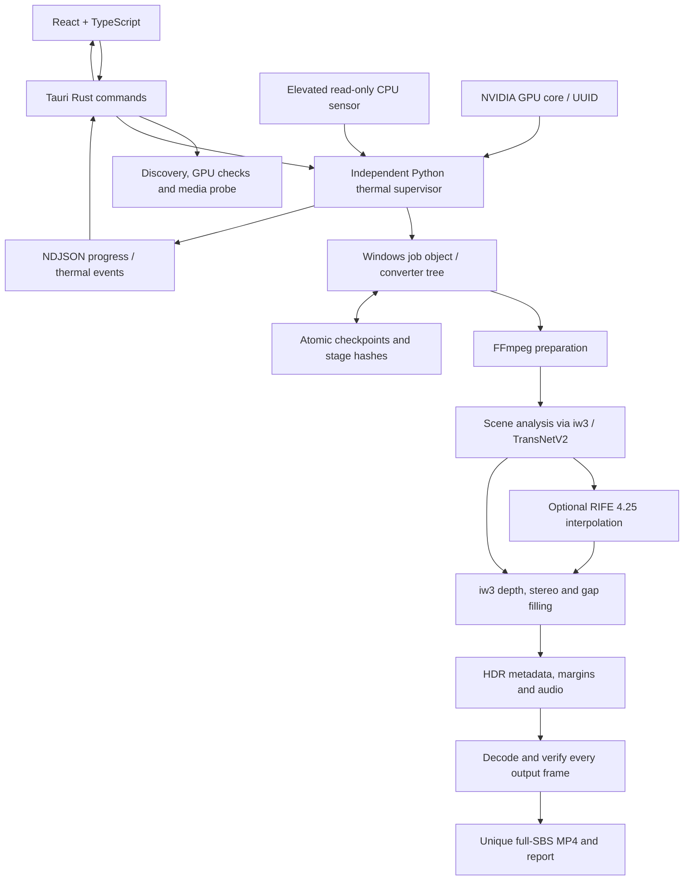

# Architecture

The interface, native process host, thermal supervisor and conversion stages have separate responsibilities.

## Important boundaries

- The frontend disables actions without required readings; the supervisor independently checks again before inference.
- Only CPU sensing requests administrator access. Readers bind to the exact parent PID/creation time and end with that instance. Conversion stays unelevated.
- A Windows job object owns each converter tree. Cutoffs, lost readings and supervisor failures terminate that tree. Resume is manual.
- A saved sensor path does not prove protection after reopening the app. Fresh permission/readings are required for each session.
- Recovery checks source identity, settings, pipeline version and stage hashes. Interrupted stages restart; existing finished outputs are never overwritten.
- Previews have explicit start/duration. Full conversion is a separate user action.

## Tradeoffs

HDR interpolation keeps PQ RGB in FP32 before 10-bit output. This avoids an SDR round trip but does not make RIFE HDR-trained. Timing is normalized to average input frame rate; footage is not bit-identical. Full movies use complete source hashes; previews explicitly use sampled hashes for responsiveness.

Scene-cut guards cannot guarantee perfect detection. Neural gap filling may reduce stretching but can invent soft detail and costs processing time. The 1.5 preset reflects local VR comparisons, not a general comfort study.

Separately licensed engines provide inference; CineVerse coordinates their execution and verifies results. Clean-machine deployment and wider GPU compatibility remain follow-up work.

## Windows CPU compatibility (0.5 preview)

`worker/hardware.py` resolves an explicit profile before work. Automatic mode can select CPU if CUDA or the NVENC probe is unavailable; explicit NVIDIA mode fails with an actionable error. CPU uses software decoding/encoding and a CPU-only PyTorch installation, refuses HDR/smoothing, and binds checkpoints to the actual backend. Legacy jobs retain their CUDA identity. CPU mode requires CPU sensing regardless of old GPU-only settings and never queries GPU temperatures. The supervisor applies a two-logical-processor affinity mask and below-normal priority before the conversion child receives its request; descendants inherit this budget. The actual conversion interpreter reapplies the budget before importing the pipeline, covering Windows venv-launcher races. Failure to apply the budget aborts the child.

The compatibility app has a separate Tauri identifier and executable so it can be evaluated beside 0.4. Setup manifests select official CPU or CUDA wheels; no multi-gigabyte runtime is stored in Git. See [compatibility](COMPATIBILITY.md) for scope and hardware evidence.
