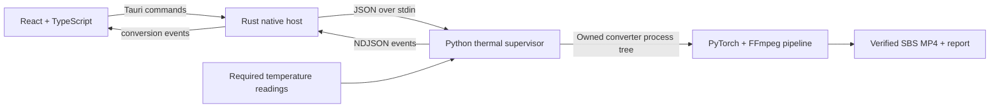

# CineVerse Desktop — developer walkthrough

[Watch the technical video — 2:58, 1080p](https://github.com/fernandohmachado8/CineVerse-Desktop/releases/download/v0.8.1-auto-setup-preview/CineVerse-Developer-Demo-0.8.1.mp4) · [Captions](https://github.com/fernandohmachado8/CineVerse-Desktop/releases/download/v0.8.1-auto-setup-preview/CineVerse-Developer-Demo-0.8.1.srt) · [Description and chapters](DEVELOPER_DEMO_DESCRIPTION.md) · [Original quick start — 1:26](DEMO_TUTORIAL.md)

This developer edition adds implementation detail to the original demonstration: native IPC, a bounded job request, model responsibilities, process supervision, recovery and measured verification. It combines **real Windows 0.8.1 app captures**, clearly explanatory diagrams and the **previously recorded actual 10-second AI export**. The engine was provisioned before capture. Editing does not represent processing throughput. This video is silent, with visible explanations and optional SRT captions.

The 30 FPS presentation repeats samples from the original 24 FPS footage; it does not apply interpolation. The standalone source and SBS files remain 24 FPS. No new inference, full-movie conversion or headset test was performed to make this edition. The original quick-start video and application installers remain preserved.

## Architecture and process boundaries



React manages user interaction, while Rust owns native commands and the active job. `start_job` sends `{config, request}` to a separate Python process. Newline-delimited JSON events from stdout pass back through `app.emit("conversion", event)`. A terminal success event alone is insufficient if the worker fails; the native host checks its exit status. Frontend controls improve the workflow, but required sensor checks are repeated in the independent supervisor.

Code: [native host](https://github.com/fernandohmachado8/CineVerse-Desktop/blob/v0.8.1-auto-setup-preview/src-tauri/src/main.rs), [worker entry point](https://github.com/fernandohmachado8/CineVerse-Desktop/blob/v0.8.1-auto-setup-preview/worker/worker.py), [architecture notes](https://github.com/fernandohmachado8/CineVerse-Desktop/blob/v0.8.1-auto-setup-preview/docs/ARCHITECTURE.md).

## Provisioning and hardware selection

Automatic setup inventories local hardware, provisions a private interpreter and dependencies, and checks the installed runtime and encoder before publishing a ready configuration. Pinned engine/model assets have integrity checks. Common Python wheels are version-pinned but do not yet have a complete per-wheel hash lock. A tiny startup probe is not sustained inference or memory certification.

Automatic can fall back to CPU when an accelerated route cannot start. Explicit GPU selections report failures. The Radeon route is allowlisted and experimental; physical Radeon execution and sensor matching remain unverified. The Apple Silicon build is a separate 0.7 preview. The developer video demonstrates **Windows NVIDIA SDR**, not all those paths.

Code: [engine bootstrap](https://github.com/fernandohmachado8/CineVerse-Desktop/blob/v0.8.1-auto-setup-preview/src-tauri/src/engine_install.rs), [setup](https://github.com/fernandohmachado8/CineVerse-Desktop/blob/v0.8.1-auto-setup-preview/scripts/setup_engine.py), [runtime capabilities](https://github.com/fernandohmachado8/CineVerse-Desktop/blob/v0.8.1-auto-setup-preview/worker/hardware.py), [hardware support and validation scope](https://github.com/fernandohmachado8/CineVerse-Desktop/blob/v0.8.1-auto-setup-preview/docs/AUTOMATIC_HARDWARE_SETUP.md).

## The actual recorded job

This normalized request excerpt comes from the completed sample job. Local source/output paths are omitted:

```json
{
  "preview": true,
  "previewStart": 0,
  "previewSeconds": 10,
  "strength": 1.5,
  "stereoMethod": "forward_inpaint",
  "fpsMode": "original",
  "processingBackend": "cuda"
}
```

The original source is analytical artwork generated by [generate_sample.py](../examples/demo/generate_sample.py): 960 × 540, 240 frames, 10 seconds, SDR at 24 FPS, no audio. Conversion used an RTX 4090, PyTorch **2.11.0+cu128**, torchvision **0.26.0+cu128** and FFmpeg **9.0.2**. The sample was actually processed in the app; the SBS pair was not manually constructed for the presentation.

Download the [2D source](https://github.com/fernandohmachado8/CineVerse-Desktop/releases/download/v0.8.1-auto-setup-preview/CineVerse-Sample-2D.mp4), [SBS result](https://github.com/fernandohmachado8/CineVerse-Desktop/releases/download/v0.8.1-auto-setup-preview/CineVerse-Sample-SBS-Depth-1.5.mp4) and [sanitized job evidence](https://github.com/fernandohmachado8/CineVerse-Desktop/releases/download/v0.8.1-auto-setup-preview/DEVELOPER-DEMO-EVIDENCE.json). Their hashes identify the exact recorded media. No private settings, local paths, device UUIDs, weights or raw logs are published.

## From depth to stereo

The pinned iw3 engine uses **Depth Anything V2 Small (`Any_V2_S`)** for relative monocular depth. iw3 maps depth to disparity, forward-reprojects a right-eye view and fills disocclusions with **`light_inpaint_v1`**. Recorded parameters include divergence **1.5**, convergence **0.5**, depth resolution **518**, edge dilation **2**, EMA normalization and EMA decay **0.75**, with scene detection enabled.

Relative depth does not establish metric geometry, a calibrated room or free viewpoint movement. The second-eye viewpoint and newly exposed texture are synthesized. The left view retains prepared source imagery, but encoding changes the pixels; output is not bit-identical video. EMA smooths depth normalization statistics, not a persistent 3D world. Scene boundaries reset temporal states; they do not guarantee correct cut detection or stable movie-wide depth. This continuous synthetic sample does not test difficult motion or cuts.

The renderer's pipeline cards explain these responsibilities; they are not invented depth-map screenshots. Code: [CineVerse pipeline](https://github.com/fernandohmachado8/CineVerse-Desktop/blob/v0.8.1-auto-setup-preview/worker/pipeline.py), [compatibility-margin adapter](https://github.com/fernandohmachado8/CineVerse-Desktop/blob/v0.8.1-auto-setup-preview/worker/iw3_export.py), [pinned iw3 implementation](https://github.com/nagadomi/nunif/blob/0d3d92c8f4396da564c44524b6390ee5c76b9668/iw3/utils.py).

## Thermal supervision and recovery

On Windows, a job object owns the converter process tree. The supervisor polls required sensors independently of the UI. Default NVIDIA thresholds are CPU **95 °C for 10 seconds / 100 °C immediate** and GPU core **85 °C for 10 seconds / 90 °C immediate**. Missing required readings for 30 seconds stop the job. Resume is manual. Only the read-only CPU sensor requests elevation; conversion stays unelevated. GPU core monitoring does not measure every hotspot or VRAM temperature, and software monitoring cannot guarantee hardware safety. The recorded sample completed with both required readings; no trip was induced for this demonstration.

Atomic stage records and SHA-256 hashes support recovery. Source identity, settings, processing backend and pipeline version are checked before reusing completed stages. A failed/interrupted stage restarts; this is not arbitrary frame-level resume. The video's four completed-stage cards and shortened hashes come from the recorded job, not fabricated progress.

Code: [supervisor](https://github.com/fernandohmachado8/CineVerse-Desktop/blob/v0.8.1-auto-setup-preview/worker/protection.py), [thermal policies](https://github.com/fernandohmachado8/CineVerse-Desktop/blob/v0.8.1-auto-setup-preview/thermal/thermal_guard.py), [stage state and verification](https://github.com/fernandohmachado8/CineVerse-Desktop/blob/v0.8.1-auto-setup-preview/worker/pipeline.py).

## Measured evidence and limits

| Check | Recorded result | What it establishes |
| --- | --- | --- |
| Output timeline | 240 frames, 24 FPS, 10 seconds; zero timestamp-grid error | Correct cadence and frame count against the prepared reference |
| Full SBS geometry | 1920 × 576; 18 black rows above/below each 960 × 540 eye image | Compatibility margins with zero removed movie pixels |
| Source identity | Preview integrity check passed; full media SHA-256 published separately | Preserved source file for this recorded run; preview identity uses sampled hashing |
| Source-eye samples | MAE 0.143–0.164 in 8-bit sample units versus prepared reference | Small sampled encoding differences; not perceptual stereo quality |
| Audio | No audio in the original sample | No claim of audio-path validation from this sample |
| Supervision | Required CPU/GPU readings remained available; finished without cutoff | A normally supervised short job, not an induced thermal-trip test |

HDR10 preservation and RIFE 60 FPS are separate supported NVIDIA paths and are **not exercised by this sample**. CineVerse's general export uses the first audio track as AAC stereo, omitting extra tracks and subtitles. Known limitations include hair, fences, reflections, disocclusions, synthesized motion and flicker. Neither this clip nor its measurements certify whole-movie quality, overnight operation, physical-headset quality of this new sample, or compatibility with every GPU.

## Reproduce or inspect

Use the [quick-start tutorial](DEMO_TUTORIAL.md) for the app workflow. Start with the published source, depth 1.5, Neural, Original FPS and a bounded 10-second preview; use shorter previews on CPU. Inspect [immutable 0.8.1 application source](https://github.com/fernandohmachado8/CineVerse-Desktop/tree/v0.8.1-auto-setup-preview) when comparing implementation claims: the repository's historical main runtime is preserved and is not a substitute for that release tag.

The presentation renderer and its input requirements are documented in [examples/demo](../examples/demo/README.md). The release includes `DEVELOPER-DEMO-PROVENANCE.json`, `DEVELOPER-DEMO-EVIDENCE.json` and `DEVELOPER-DEMO-SHA256SUMS.txt`. They distinguish presentation validation from the earlier recorded conversion. The 86-second quick start remains available. Both editions now use an untouched recorded temperature panel with the pointer outside the crop; the displayed readings belong to that recorded state and were not retouched. Presentation hashes reflect this edit; the source/SBS samples and recorded conversion evidence remain unchanged.

Original artwork and CineVerse application code are MIT licensed. Stereo inference is provided by [iw3 / nunif](https://github.com/nagadomi/nunif) and [Depth Anything V2](https://github.com/DepthAnything/Depth-Anything-V2); optional smoothing uses [Practical-RIFE](https://github.com/hzwer/Practical-RIFE). Dependencies and weights retain their own licenses. Bigscreen is a separate playback app; no affiliation is implied. No movie frames, book text, external artwork, narration or music are included.
