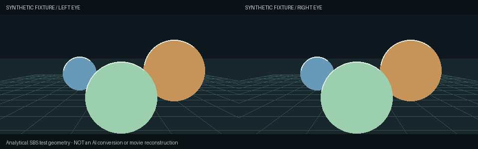

# Validation — 31 October 2026

This standalone repository extracts the desktop converter from the larger CineVerse workspace. The existing application, source repository and movie exports were left intact. Evidence below separates source checks, native hardware runs and untested deployment claims.

## Automatic setup preview — 0.6

The current setup preview has **102 passing local tests**: 59 Python, 22 React, 14 legacy watchdog and 7 Rust bootstrap tests. New checks cover Git-free source archives/receipts, runtime pins and foreign-folder refusal, Windows long-path extraction, bounded network retries, consent/cancellation/configuration adoption, hash/path/symlink rejection and an actual Windows kill-on-close job that preserves another disposable process.

A Windows NSIS installer was built and installed as the separate **CineVerse Setup Preview** application. Its setup-only bootstrap ran with PATH restricted to Windows System32, so no system Python or Git could be used. It downloaded private CPython 3.12.16, created a CPU-only PyTorch 2.11.0 environment, installed the pinned wheel snapshot, video/sensor tools, pinned commit archives and six model files in a new engine folder. All configured engine paths belonged to that folder; optional RIFE paths were intentionally absent for CPU mode. The signed PawnIO 2.2.0 installer was downloaded and its signature checked, but it was not executed or installed.

The first attempt took 182.384 seconds and stopped at a Windows source-ZIP path-length error after package installation. Extended-path extraction fixed this without changing registry/security settings. A 5.802-second retry reused completed stages but encountered a remote connection reset for the final model. The official Hugging Face download URL and bounded retry behavior were corrected; a subsequent 31.159-second retry verified the remaining download and completed imports/software encoding. Hash failures remain fatal. These are observed recovery measurements, not an uninterrupted clean-machine timing promise.

CI exposed a stale native drag/drop callback that could restore initial empty paths after settings loaded. The native subscription now reads its current handler from a ref, with a regression that invokes an early callback and verifies the saved engine paths.

The native first-run UI was then exercised: CPU package, engine drive selection, download consent and **Install engine automatically**. It reused the verified engine, saved every path, closed the setup dialog and selected CPU/original-FPS mode. Saved settings were checked; no sensor session was persisted and no movie conversion was triggered by setup. Both previous installed application hashes remained unchanged.

A three-second 640x360/24 FPS synthetic preview ran through the packaged worker with this newly installed CPU engine in **156.875 seconds**. All **72 frames** verified, with zero timestamp-grid error, preserved prepared audio, passed source integrity/detail checks and 12-row top/bottom compatibility margins. It recorded 75 valid active CPU samples at 73.0-92.0 C. This was a CLI-supervised preview; the native buttons were used for setup, not for this conversion. [Machine-readable evidence](automatic-setup-benchmark.json) omits private paths.

This workstation already had WebView2, Windows runtime components and an approved PawnIO driver. A completely clean Windows VM, absent WebView2/driver paths and a fresh CUDA/RIFE installation are not yet certified. The private CPU environment and download/install flow are distinct from broad hardware certification. No film data was used in setup or published.

## Local checks — 0.5 compatibility preview

| Check | Evidence |
|---|---|
| Python worker/setup/protection/distribution | 52 passed, including backend selection/fallback, unsupported-mode refusal, CPU sensor requirements, checkpoint backend identity and real Windows process affinity |
| React | 18 passed, including CPU controls, HDR/60 FPS gating and delayed startup detection before planning |
| Legacy watchdog | 14 passed on Windows, using disposable processes |
| CPU Python environment | Fresh venv with official PyTorch 2.11.0+cpu / torchvision 0.26.0+cpu and the pinned package snapshot; CUDA unavailable; `pip check` passes |
| TypeScript/Vite and formatting | Production build and formatting checks pass |
| Windows package | Rust MSVC/NSIS 0.5.0 Compatibility Preview built separately; 0.4 installed executable SHA-256 unchanged |
| Publication | Git-index audit checks private paths/tokens, unregistered binary assets, weights and settings |

**84 tests total:** 52 Python, 18 React and 14 legacy thermal tests. Linux skips five Windows-only disposable-process tests. CI verifies source/UI behavior without CUDA inference or live CPU sensors. Historical 0.4 validation had 71 tests.

## Measured CPU-only run and GPU regression

The same generated FFmpeg test pattern with sine audio (640x360, 24 FPS, three seconds) was converted at strength 1.5 using neural gap filling and Original FPS. No movie was used in these compatibility tests. Machine: Windows x64, Intel i9-14900KF; an RTX 4090 is physically installed but the CPU test used a separate **CPU-only PyTorch build**, hid CUDA from the worker, selected `--gpu -1`, and used software H.264.

| Measurement | CPU compatibility | NVIDIA regression |
|---|---|---|
| End-to-end wall time | 160.531 seconds | 17.360 seconds |
| Verified frames / FPS | 72 / 24 | 72 / 24 |
| Output dimensions | 1280x384 full SBS, including margins | 1280x384 full SBS, including margins |
| PTS first / last | 0 / 2.9583333333 seconds | Same |
| Timestamp grid error | Zero | Zero |
| Prepared audio / source integrity | Passed | Passed |
| Source-eye sampled luma MAE | 0.525-0.550 on an 8-bit scale | 0.171-0.199 |
| Top / bottom margin | 12 rows each; no image pixels removed | Same |
| Active thermal samples | 77 valid; CPU 62-93 C, GPU not queried | 7 valid; CPU 79-85 C, GPU 45.68-58.27 C |

[Machine-readable measurements](compatibility-benchmark.json) omit private paths. Source-eye comparisons are against the prepared resized/reencoded reference, not a claim of bit-exact original pixels or correct inferred depth. This simple pattern verifies the pipeline, timing and encoding; it does not establish photographic depth quality, sustained load, VR comfort or laptop speed. The configured 1280-pixel-per-eye cap was not separately benchmarked at that maximum input size.

An earlier CPU attempt used library thread limits without a process-tree affinity budget. It reached the **100 C immediate cutoff after 48.109 seconds**, and the supervisor stopped conversion with no completed export. The machine was not deliberately overheated. The subsequent successful run applies a two-logical-processor budget inherited by decoder/encoder/inference descendants. Cutoffs were not raised or disabled.

Fresh CPU wheels/packages were installed, but iw3/checkpoints/FFmpeg and PawnIO/sensor files came from the already configured workstation. A complete installer run on a clean non-NVIDIA PC remains unverified. The NVIDIA regression is SDR/original FPS; the HDR/60 FPS evidence below belongs to the preserved 0.4 baseline.

Native startup was inspected separately. CPU mode shows software encoding, the 1280 limit, disabled smoothing, GPU “Not used” and blocked conversion before CPU readings. Inspection exposed an initial planning race while CPU detection was loading; planning now waits for engine readiness, with a delayed-detection regression test. No full-movie job was started.

## Measured native behavior

Before extraction, desktop 0.4 was tested on Windows with an i9-14900KF, RTX 4090, CUDA PyTorch 2.11.0+cu128, iw3 and RIFE 4.25. These are historical local measurements of the code being extracted, not GPU work performed by GitHub Actions.

- A three-second HDR10/60 FPS window completed through the packaged worker in 47.97 seconds: 181 frames, 3840×832, first PTS 0, last PTS 3.0 and zero frame-grid error. Fractional-rate preparation accounts for the small duration extension. HDR10 metadata, prepared audio, sampled source integrity, source-eye samples and 14-row compatibility margins passed.
- Its 22 active thermal samples were all available: CPU 72–85 °C and GPU core 39.71–62.53 °C.
- A second three-second preview was launched through native app controls. The UI moved from Ready to arm → Monitoring → Your stereo video is ready. The saved request confirmed preview mode, duration 3, depth 1.5, neural filling and 60 FPS. All 20 active samples were ready: CPU 73–86 °C, GPU core 39.88–60.36 °C. Output had 181 verified frames.
- Native engine discovery found eight components with Advanced paths collapsed. CPU-helper activation and startup without readings were exercised. Closing the app ended its bound CPU reader.
- Two startup faults were fixed: extended Win32 resource paths were normalized for normal PowerShell signing semantics, and helper-launch IPC pipe inheritance was suppressed so the app can receive startup completion. No execution-policy/security setting was changed.

The source and output of those private film tests are not included. No film imagery or source filenames are used as portfolio assets. The original wider workspace had 31 additional reconstruction tests, but those are **not counted** as tests of this standalone repository.

## Reproduce without copyrighted footage

```powershell
python -m unittest discover -s tests -v
python -m unittest discover -s thermal -v
npm ci
npm test
npm run build

# Optional: Pillow is needed only to generate original synthetic assets.
python -m pip install -r requirements/test.txt
python examples/generate_fixture.py --video "PATH_OUTSIDE_REPO/synthetic.mp4" --ffmpeg "PATH_TO_FFMPEG"
```

Configure the Windows engine, enable CPU sensing and wait for Ready to arm. Select the generated local video, choose a three-second preview and Generate preview. Inspect the final report and private job's `protection.jsonl`. Do not call the internal `convert` child mode directly or start a full movie as a test.



This is a directly rendered analytical stereo fixture, **not an AI conversion result**. Its source generator and asset hashes are committed. It is suitable as a deterministic input and illustration; it does not establish real-world depth accuracy.

## Limits and remaining work

A new clean Windows machine, unattended overnight operation, other CPU/GPU models, whole-film neural visual quality, VR comfort and every scene cut have not been certified. The dependency helper's safeguards and existing-engine check are tested; a complete fresh dependency install is not claimed. Native inference tests are distinct from CPU-only CI. Temperature fault injection uses disposable processes; the real CPU cutoff observed during compatibility testing is documented above. Hardware is not deliberately overheated. Software polling cannot guarantee hardware safety or monitor GPU VRAM/hotspot temperatures.

The project is an experimental portfolio application with measured capabilities and explicit limits, not a production certification or a new model-research claim.
